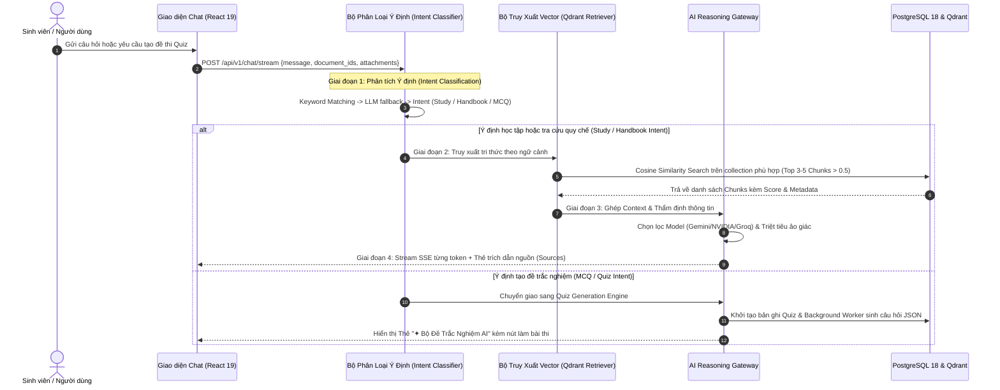

# 🏛️ TỔNG QUAN KIẾN TRÚC HỆ THỐNG & AI AGENT WORKFLOW — STUDYAI
> **Tài liệu đặc tả kỹ thuật, danh mục API và chu trình tư duy tác tử tự chủ (Autonomous RAG Agent)**  
> *Đồng bộ hóa 100% với hệ thống mã nguồn thực tế (FastAPI, SQLModel, PostgreSQL 18, Qdrant Vector Engine)*

---

## 📌 1. BẢNG TỔNG HỢP TOÀN BỘ API VÀ HÀM XỬ LÝ (BACKEND ENDPOINTS & CORE FUNCTIONS)

Toàn bộ Backend FastAPI của StudyAI được tổ chức theo cấu trúc RESTful & Streaming SSE (Server-Sent Events) tại prefix `/api/v1`:

### 1.1. Module Trợ lý AI & Hội thoại (`/api/v1/chat`)
| Endpoint / Function | Method | Quyền hạn | Mô tả & Chức năng chi tiết |
| :--- | :---: | :---: | :--- |
| `/api/v1/chat/stream` | `POST` | User | **Core Chat Engine:** Truyền phát SSE thời gian thực. Tự động kích hoạt bộ phân loại ý định (Intent Classifier), đối soát Vector RAG trên tài liệu người dùng (`docs_user_{id}`) hoặc sổ tay sinh viên (`handbook_shared`), stream từng token về giao diện. |
| `/api/v1/chat/demo/stream` | `POST` | Public | Endpoint trải nghiệm nhanh tại Landing Page không yêu cầu đăng nhập. Tích hợp Rate-limiting theo IP (tối đa 5 lượt/phút) và đối soát trực tiếp trên kho quy chế `handbook_shared`. |
| `/api/v1/chat/conversations` | `GET` | User | Lấy danh sách lịch sử hội thoại của sinh viên, sắp xếp giảm dần theo thời gian cập nhật. |
| `/api/v1/chat/conversations/{id}/messages` | `GET` | User | Lấy toàn bộ lịch sử tin nhắn trong hội thoại, kèm danh sách nguồn trích dẫn RAG (`sources`), file đính kèm (`attachments`) và liên kết bài Quiz (`quiz_id`). |
| `/api/v1/chat/conversations/{id}` | `DELETE` | User | Xóa vĩnh viễn cuộc hội thoại và kích hoạt xóa xếp tầng (Cascade delete) toàn bộ tin nhắn và đánh giá liên quan. |
| `/api/v1/chat/messages/{id}/feedback` | `POST` | User | Ghi nhận đánh giá phản hồi (`thumbs_up` / `thumbs_down` kèm `comment`) từ sinh viên để phục vụ kiểm thử và tinh chỉnh RAG. |
| `/api/v1/chat/messages/{message_id}/quiz` | `PATCH` | User | Liên kết mã `quiz_id` vào tin nhắn trợ lý để lưu vết và kích hoạt nút bấm "🚀 Vào Làm Bài Quiz Ngay" trên giao diện hội thoại. |

---

### 1.2. Module Kho Tài Liệu & Tri Thức (`/api/v1/documents`)
| Endpoint / Function | Method | Quyền hạn | Mô tả & Chức năng chi tiết |
| :--- | :---: | :--- | :--- |
| `/api/v1/documents/` | `POST` | User | **Tải lên tài liệu:** Nhận file (`pdf`, `docx`, `pptx`, `txt`, `md`), kiểm tra dung lượng (giới hạn 200MB), lưu trữ vật lý vào thư mục `/app/uploads` và kích hoạt Background Worker thực hiện quy trình bóc tách văn bản, chunking và sinh vector. |
| `/api/v1/documents/` | `GET` | User | Danh sách tài liệu cá nhân của người dùng kèm metadata: tên file, kích thước, phân loại môn học (`folder`), danh mục (`category`), trạng thái (`pending`, `indexing`, `ready`, `failed`). |
| `/api/v1/documents/{id}` | `GET` | User | Chi tiết trạng thái tài liệu phục vụ cơ chế kiểm tra tiến trình (polling). |
| `/api/v1/documents/{id}` | `PATCH` | User | Cập nhật phân loại môn học (`folder`), danh mục (`category`), nhãn (`tags`). Khi chuyển đổi danh mục thành `handbook`, tài liệu sẽ tự động được đồng bộ vào bộ sưu tập vector dùng chung `handbook_shared`. |
| `/api/v1/documents/{id}` | `DELETE` | User | Xóa toàn diện tài liệu: xóa file vật lý trên đĩa cứng, xóa toàn bộ vector chunks khỏi Qdrant (`delete_document_from_qdrant`), xóa các bài thi Quiz liên quan và xóa cascade bảng `documentchunk` trong PostgreSQL. |
| `/api/v1/documents/{id}/chunks` | `GET` | User | Xem danh sách các phân đoạn văn bản (`chunk_text`, `chunk_index`, `token_count`) đã được trích xuất và lưu trong cơ sở dữ liệu. |

---

### 1.3. Module Khảo Thí & Tạo Đề Trắc Nghiệm AI (`/api/v1/quiz`)
| Endpoint / Function | Method | Quyền hạn | Mô tả & Chức năng chi tiết |
| :--- | :---: | :--- | :--- |
| `/api/v1/quiz/generate` | `POST` | User | Khởi tạo yêu cầu sinh đề trắc nghiệm (10, 20, 30 hoặc 50 câu) từ 1 hoặc nhiều tài liệu học tập cùng lúc. Kích hoạt background task `generate_quiz_background` chia batch thông minh. |
| `/api/v1/quiz/` | `GET` | User | Lấy danh sách các bộ đề trắc nghiệm của sinh viên theo thứ tự mới nhất. |
| `/api/v1/quiz/{quiz_id}` | `GET` | User / Public | Lấy thông tin bộ đề kèm số lượng câu hỏi hiện tại đã sinh xong (`current_question_count`) phục vụ hiển thị thanh tiến độ sinh bài thời gian thực. |
| `/api/v1/quiz/{quiz_id}/questions` | `GET` | User / Public | Lấy danh sách câu hỏi và các lựa chọn A/B/C/D (đáp án đúng và giải thích được ẩn đi khi đang làm bài). |
| `/api/v1/quiz/{quiz_id}/submit` | `POST` | User | Nộp bài làm trắc nghiệm, hệ thống tự động chấm điểm, tính tỷ lệ phần trăm chính xác, lưu kết quả vào `quiz_attempt` và trả về bảng đáp án kèm lời giải chi tiết từng câu. |
| `/api/v1/quiz/{quiz_id}/attempts` | `GET` | User | Lịch sử các lần làm bài của sinh viên cho bộ đề này. |
| `/api/v1/quiz/{quiz_id}/share` | `PATCH` | User | Bật/tắt trạng thái chia sẻ công khai (`is_public`) để bạn bè hoặc sinh viên khác có thể cùng truy cập làm bài qua đường link chia sẻ. |

---

### 1.4. Module Quản Trị Hệ Thống & Cấu Hình AI Gateway (`/api/v1/admin` & `/api/v1/admin/ai`)
| Endpoint / Function | Method | Quyền hạn | Mô tả & Chức năng chi tiết |
| :--- | :---: | :--- | :--- |
| `/api/v1/admin/health` | `GET` | Superuser | Kiểm tra sức khỏe toàn diện hệ thống: tải CPU (`psutil.cpu_percent`), mức chiếm dụng RAM, và kiểm tra kết nối API tới từng nhà cung cấp AI. |
| `/api/v1/admin/feedback` | `GET` | Superuser | Xem danh sách đánh giá phản hồi (👍/👎) từ sinh viên để phát hiện các câu hỏi bị ảo giác thông tin hoặc cần điều chỉnh prompt. |
| `/api/v1/admin/ai/models` | `GET` / `POST` | Superuser | Quản lý danh sách các mô hình AI: nhà cung cấp (`gemini`, `nvidia`, `groq`), model ID, base URL và lưu trữ API Key mã hóa AES-256 an toàn trong bảng `aimodelconfig`. |
| `/api/v1/admin/ai/models/{id}` | `PUT` / `DELETE` | Superuser | Cập nhật cấu hình mô hình, bật/tắt kích hoạt (`is_active`), gán cờ embedding (`is_embedding`), thay đổi thứ tự ưu tiên (`priority`), tự động kích hoạt hot-reload trên toàn hệ thống. |
| `/api/v1/admin/ai/models/{id}/test` | `GET` | Superuser | Gửi lệnh kiểm thử trực tiếp bằng API Key đã giải mã để đo độ trễ và tính khả dụng của provider. |
| `/api/v1/admin/ai/prompts` | `GET` / `POST` / `DELETE` | Superuser | Quản lý kho System Prompts tùy chỉnh được cấu hình động cho hệ thống. |

---

### 1.5. Module Hồ Sơ Cá Nhân & Xác Thực (`/api/v1/profile`, `/api/v1/users`, `/api/v1/login`)
| Endpoint / Function | Method | Quyền hạn | Mô tả & Chức năng chi tiết |
| :--- | :---: | :--- | :--- |
| `/api/v1/login/access-token` | `POST` | Public | Đăng nhập bằng Email & Password, trả về JWT Token (`OAuth2PasswordRequestForm`). |
| `/api/v1/users/signup` | `POST` | Public | Đăng ký tài khoản sinh viên mới vào hệ thống. |
| `/api/v1/profile/me` | `GET` / `PATCH` | User | Xem và cập nhật thông tin tài khoản cá nhân (`full_name`, `email`). |
| `/api/v1/profile/me/password` | `PATCH` | User | Đổi mật khẩu cá nhân có kiểm tra đối soát mật khẩu cũ. |

---

### 1.6. Các Hàm Xử Lý Cốt Lõi Tầng Dưới (Core Python Pipeline Functions)
* **`parse_document(file_path: str, file_type: str) -> str`:** Tự động nhận diện định dạng và phân phối tới parser tương ứng: `fitz` (PyMuPDF) cho PDF, `python-docx` cho Word, `python-pptx` cho PowerPoint và đọc plain-text có hỗ trợ tự động xử lý bảng mã tiếng Việt.
* **`chunk_text(text: str, chunk_size: int = 500, overlap: int = 50) -> list[TextChunk]`:** Thuật toán cắt phân đoạn từ trượt với độ dài 500 từ (~650-700 tokens tiếng Việt) và 50 từ gối đầu (overlap) giúp triệt tiêu hiện tượng đứt gãy ngữ cảnh giữa các đoạn liên tiếp.
* **`embed_text(text: str) -> list[float]`:** Chuyển đổi đoạn văn bản thành vector đặc trưng 768 chiều (thông qua `ai_gateway.embed`).
* **`retrieve(query, collection_name, top_k=5, score_threshold=0.5)`:** Tìm kiếm vector ngữ nghĩa tương đồng (Cosine Similarity) trên Qdrant Engine với ngưỡng lọc chất lượng tối thiểu.
* **`ai_gateway.chat()` / `ai_gateway.stream()`:** Lớp cổng điều phối đa tầng: Ưu tiên phân phối tới model chỉ định hoặc duyệt theo chuỗi dự phòng (Fallback Chain: Gemini → NVIDIA → Groq) khi gặp lỗi Rate Limit (429) hoặc Server Error (5xx).
* **`ai_gateway.generate_json()`:** Hàm sinh dữ liệu JSON có cấu trúc chuyên dụng: tự động loại bỏ thẻ tư duy `<think>...</think>`, bóc tách code block markdown và quét mảng JSON outermost `[...]` chống hiện tượng lỗi token.

---

## 🤖 2. QUY TRÌNH HOẠT ĐỘNG CỦA AI AGENT (AI AGENT LIFECYCLE & REASONING FLOW)

AI Agent trong StudyAI vận hành theo kiến trúc **Autonomous RAG Agent (Tác tử Tự chủ Sinh tăng cường Truy xuất)** gồm 4 giai đoạn khép kín:

### Chi tiết 4 giai đoạn tư duy của Agent:
1. **Lắng nghe & Phân loại Ý định (Intent Classification):**
   * *Bước 1:* Quét nhanh qua từ điển từ khóa tiếng Việt (`HANDBOOK_KEYWORDS`, `MCQ_KEYWORDS`).
   * *Bước 2:* Nếu không khớp từ khóa, gọi mô hình LLM với nhiệt độ T=0.0 và giới hạn 10 tokens để phân loại chính xác ý định người dùng.
   * *Bước 3:* Tự động điều hướng câu hỏi về kho dữ liệu phù hợp: tài liệu người dùng (`answer_from_user_docs`), sổ tay dùng chung (`answer_from_handbook`), hoặc chế độ tự chủ toàn kho (`answer_autonomous`).
2. **Truy xuất Tri thức Đa miền (Context Retrieval):**
   * Vector hóa câu hỏi thành không gian tọa độ 768 chiều.
   * Thực hiện phép đo khoảng cách Cosine trên Qdrant Engine với cấu trúc đồ thị đa tầng HNSW để trích xuất 3 đến 5 đoạn văn bản có độ tương đồng cao nhất.
3. **Thẩm định & Chống Ảo giác (Grounding & Fact-checking):**
   * Hệ thống đóng gói System Prompt nghiêm ngặt, ràng buộc AI chỉ được tổng hợp câu trả lời dựa trên tài liệu được cung cấp. Nếu tài liệu không chứa dữ liệu cần thiết, AI bắt buộc phải trả lời trung thực: *"Tài liệu không đề cập đến vấn đề này"*.
   * Tự động điều chỉnh ngữ pháp và sửa lỗi mất dấu scan OCR từ tài liệu gốc.
4. **Phản hồi Tương tác (Actionable Response):**
   * Phản hồi dạng Stream SSE giúp giảm tối đa độ trễ hiển thị (Time to First Token < 0.9s).
   * Đi kèm thẻ trích dẫn nguồn có thể mở rộng (tên file, đoạn số mấy, điểm tương đồng %) và nút bấm làm Quiz trực tiếp nếu người dùng yêu cầu bài kiểm tra.

---

## 🚀 3. ĐỊNH HƯỚNG PHÁT TRIỂN TƯƠNG LAI (FUTURE ROADMAP)

Hệ thống StudyAI được hoạch định mở rộng theo 4 trụ cột công nghệ chiến lược:

1. **Ứng dụng GraphRAG (Knowledge Graph RAG):**
   * Tích hợp cơ sở dữ liệu đồ thị tri thức (Neo4j) để mô hình hóa cây quan hệ giữa các môn học tiên quyết, khái niệm cốt lõi và lộ trình đào tạo theo từng chuyên ngành.
2. **Tác tử Chấm điểm Tự luận & Phân tích Sơ đồ Tư duy (Mindmap Agent):**
   * Xây dựng Agent chuyên trách đọc bài làm tự luận của sinh viên, chỉ ra các bước sai sót trong chuỗi suy luận logic và tự động sinh mã Mermaid / Mindmap trực quan tóm tắt toàn bộ bài học.
3. **Trợ lý Hội thoại Giọng nói Thời Gian Thực (Voice AI Tutor):**
   * Tích hợp WebRTC và Live Audio Streaming cho phép sinh viên trực tiếp hỏi đáp, luyện tập phỏng vấn chuyên ngành hoặc thuyết trình bằng giọng nói tự nhiên.
4. **Tích hợp Hệ sinh thái Quản lý Đào tạo Nhà trường (LMS / Canvas / Moodle):**
   * Kết nối cổng API LTI (Learning Tools Interoperability) để tự động đồng bộ bài giảng, lịch thi và kết quả làm Quiz vào hệ thống quản lý học tập chính thức của nhà trường.
